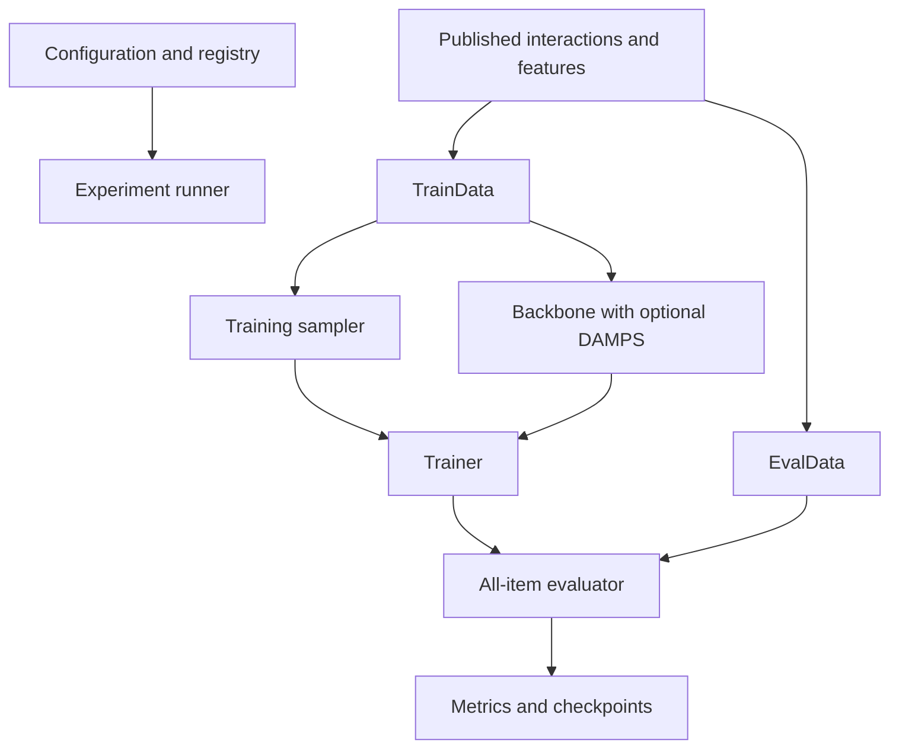

# Architecture

English · [简体中文](zh/architecture.md) · [Documentation](README.md)

The registry declares each backbone's required modalities and batch type. The experiment runner uses those declarations to build the model, sampler, trainer, and evaluator. The trainer does not branch by model name or DAMPS configuration. For a file-by-file reference, see the [code map](code-map.md).

## Data and ranking boundaries

- `TrainData` contains global dimensions, training edges/history, all item features, and a fingerprint. `EvalData` holds held-out targets. DAMPS is transductive: it can use all released item features but not held-out interactions to construct graphs or estimate initialization statistics.
- BM3 uses positive-only batches. Models that need negatives sample from the complement of a user's training positives, not using validation or test labels.
- Graphs are sparse. Exact kNN computes similarities in blocks; cache keys include input fingerprints and graph options. Raw-feature graphs can be rebuilt or loaded from cache; FREEDOM also saves its initialization-dependent calibrated item graph in the checkpoint.
- The evaluator ranks all items in user and item blocks, masking history before top-k. Ties favor smaller item IDs; padded candidates do not count. Recall and NDCG are macro-averaged over eligible users. By default both splits mask training history; `eval.history=train_valid` additionally masks validation history for test evaluation.

## Model and trainer contract

The factory receives model config, `TrainData`, and a graph cache. `compute_loss(batch)` returns a scalar loss, named components, and batch size. The trainer performs backward and optimizer updates, records first-batch diagnostics, and uses validation Recall@20 by default for early stopping and checkpoint selection. The evaluator calls `make_scorer()` once per evaluation to encode representations under evaluation/no-grad mode before blocked scoring. It does not reuse a scorer across parameter updates or checkpoint loads.

[DAMPS](damps.md) is a model component, not a separate training stage. Each backbone defines where it applies calibration and whether the calibration parameters receive gradients. Whenever enabled components need initialization statistics, those statistics come from all initial item projections, not a training mini-batch.

## Configuration and run state

Precedence is **shared defaults → dataset → model → experiment → CLI overrides**. Unknown keys are rejected; relative paths resolve against the repository root. `model.name` selects the backbone and `model.damps_enabled` toggles calibration.

Each run keeps its final YAML, environment and data manifest, epoch metrics, checkpoints, and result under `runs/`. DAMPS runs have a `damps-` prefix. Checkpoints include optimizer, scheduler, sampler, RNG, epoch, and early-stopping state. Resume checks data and config compatibility and continues at an epoch boundary in the original directory. It does not migrate old incompatible checkpoints or guarantee bitwise equivalence across devices and dependency versions.
