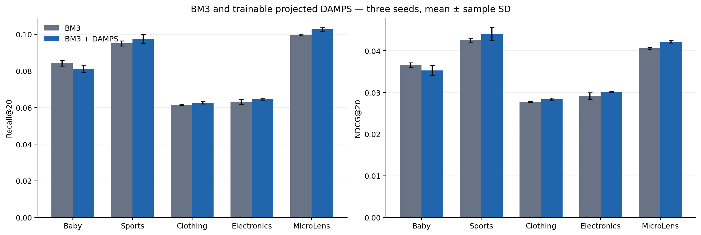

# BM3 与 BM3+DAMPS 五数据集三种子结果

BM3+DAMPS 的 **15/15 次正式训练及最佳 checkpoint 独立重载核验已完成**，最后一组于 2026-11-12 20:52（北京时间）结束。Baby、Sports、Clothing、Electronics、MicroLens 均使用种子 **999、2024、2025**。原始 BM3 的相同 15 次既有结果作为配对对照；原来的五种子归档保留。本次不包含已取消的消融实验和种子 2026、42。

## 结果

下表为三个种子的测试集 Recall@20 均值。相对变化为 `(full / baseline - 1) × 100%`。

| 数据集 | BM3 | BM3+DAMPS | 相对变化 |
| --- | ---: | ---: | ---: |
| Baby | 0.084267 | 0.081133 | −3.72% |
| Sports | 0.095067 | 0.097500 | +2.56% |
| Clothing | 0.061467 | 0.062667 | +1.95% |
| Electronics | 0.063167 | 0.064500 | +2.11% |
| MicroLens | 0.099600 | 0.102733 | +3.15% |

四项指标（Recall/NDCG@10/20）合计 20 个均值中，16 项高于相同种子的原始 BM3，Baby 的四项低于 BM3。Recall@20 的同种子差值在 Clothing、Electronics、MicroLens 的三个种子上均为正，Sports 为两个正、一个负，Baby 三个均为负。这些结果描述本次固定配置下的变化；三个种子的标准差不构成统计显著性结论。



## 实验协议与接入方式

- 使用与原始 BM3 完全相同的数据划分、特征与训练配置，逐项检查数据指纹和对应种子的配置。未使用测试集选择参数。
- embedding 和图文投影均为 64 维。最多 1000 轮，按首次验证 Recall@20 最大值选模，连续 21 轮不提升时停止。测试全物品排序屏蔽训练历史，保留验证交互，沿用原始 BM3 的指标计算与四位小数舍入。
- 采用 **projected_trainable_v1**：在 BM3 的 64 维图文投影后，每次训练损失计算都执行组内共享 DAMPS，使校准参数获得梯度。最终推荐打分仍使用原 BM3 的用户与物品表示。完整模块增加 101 个可训练标量。
- 作者 v1.0.0 BM3 适配器在初始化时调用校准，再把输出包装成独立 embedding，切断了后续损失到 DAMPS 参数的梯度；其重建宽度也不同。因此本结果应称为上述可训练接入的实验，不能当作未修改作者适配器的精确复现。源码审计及参考文件见[接入说明](../../../baselines/bm3_damps/README.md)。
- 全部 15 次训练的四项验证指标、四项测试指标和最佳轮次均与独立重载结果一致。`sample_std` 使用 n−1 分母；差值按相同种子配对。环境为 Python 3.8.20、PyTorch 2.4.1+cu121、RTX 3090。

## 文件与核验

| 文件 | 用途 |
| --- | --- |
| [runs.json](runs.json) | 15 次 DAMPS 与 15 次原始 BM3 的配置、指标、最佳轮次及重载结果 |
| [summary.csv](summary.csv)、[summary.json](summary.json) | 五数据集、两模型、四指标的三种子均值与样本标准差 |
| [paired-contrasts.csv](paired-contrasts.csv) | 同种子差值均值、差值标准差、均值相对变化与正差值次数 |
| [training-plan.json](training-plan.json) | 实际执行配置及用户缩减实验范围的记录 |
| [provenance.json](provenance.json) | 执行源码、历史、原始指标及 checkpoint 的 SHA256 |
| [paired-main-sheet.tsv](paired-main-sheet.tsv) | 与 Google 表格行顺序一致的 BM3 / BM3+DAMPS 两列 |
| [google-sheets-delivery.json](google-sheets-delivery.json) | 上传目标、三种子口径和 40 个数值的回读核验记录 |
| `histories/`、`baseline-histories/` | 15 次 DAMPS 与 15 次配对 BM3 的完整逐轮训练与验证历史 |
| [packaging.json](packaging.json) | 迁移后的代码位置、快照文件哈希与可移植路径调整 |
| `figures/` | 均值/标准差对照及同种子连线图，PNG/PDF 两种格式 |

从仓库根目录执行轻量核验，无需 GPU 或训练数据：

```bash
python baselines/bm3_damps/verify.py
```

校验同时检查源码身份、三种子覆盖、重载、历史选模/早停、配置、数据指纹及汇总。跨 Python 版本重算标准差时允许 1e-12 相对或 1e-15 绝对浮点误差；原始运行、数据和源码哈希仍严格一致。

已按小组既有格式填入 [Google 表格](https://docs.google.com/spreadsheets/d/1cn-XI8QMNgfaHDFhru-nk8k3NYC_jIrblqfPF2lOP8E/edit#gid=0) 的主实验 O/P 列，显示四位小数、底层保留完整均值。O 列更新为相同三种子的 BM3，对其他组员单元格和备注的回读检查无变化。

源码及原始 BM3 依赖冻结于 `baselines/bm3_damps/snapshot/`，可独立于主分支的新统一训练框架使用。`provenance.json` 中的源码路径相对于该快照根目录。公开元数据移除了设备 UUID；所有指标、配置、训练摘要及历史内容保持不变。
