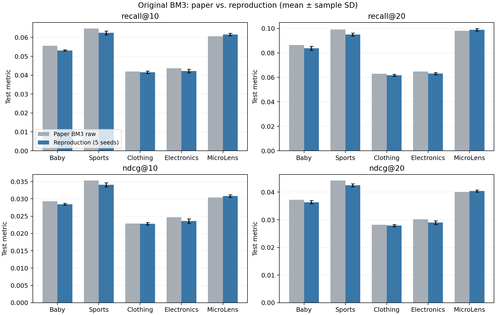
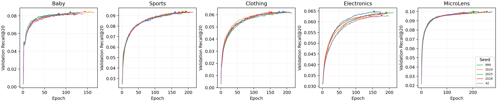

# BM3 五数据集五种子实验结果

本目录交付原始 BM3 在 Baby、Sports、Clothing、Electronics、MicroLens 上的 **25 次正式实验**。每个数据集固定使用种子 999、2024、2025、2026、42；全部结果经过最佳 checkpoint 独立重载核验。Baby 于 2026-11-07 完成，其余四个数据集于 2026-11-12 完成（北京时间）。

## 结果与论文对照

下面为五种子的测试集 Recall@20 算术平均。论文参考值取自仓库 [DAMPS.pdf](../../../DAMPS.pdf) 的 Table 2、BM3/raw 列（PDF 第 7 页，印刷页码 1465）。相对差异为 `100 × (本地均值 / 论文值 − 1)`。

| 数据集 | 本地 BM3 | 论文 BM3 raw | 相对差异 |
| --- | ---: | ---: | ---: |
| Baby | 0.08376 | 0.0865 | -3.17% |
| Sports | 0.09512 | 0.0992 | -4.11% |
| Clothing | 0.06174 | 0.0629 | -1.84% |
| Electronics | 0.06310 | 0.0648 | -2.62% |
| MicroLens | 0.09896 | 0.0981 | +0.88% |

五数据集四项指标共 20 项，16 项低于论文、4 项高于论文。相对差异范围为 −4.57% 至 +1.52%；MicroLens 四项均略高，其余四个数据集均略低。各项相对偏差的绝对值均低于 5%，说明本次固定配置结果接近论文中的原始 BM3。五种子重复度量了本次实现的波动，不能单独确定与论文差异的原因。

| 数据集 | 完成数 | R@10 | R@20 | NDCG@10 | NDCG@20 |
| --- | --- | ---: | ---: | ---: | ---: |
| Baby | 5/5 | 0.05306 ± 0.000336 | 0.08376 ± 0.001592 | 0.02846 ± 0.000261 | 0.03634 ± 0.000586 |
| Sports | 5/5 | 0.06238 ± 0.001008 | 0.09512 ± 0.001221 | 0.03408 ± 0.000559 | 0.04248 ± 0.000581 |
| Clothing | 5/5 | 0.04158 ± 0.000634 | 0.06174 ± 0.000740 | 0.02280 ± 0.000346 | 0.02790 ± 0.000406 |
| Electronics | 5/5 | 0.04220 ± 0.000875 | 0.06310 ± 0.000980 | 0.02358 ± 0.000661 | 0.02900 ± 0.000667 |
| MicroLens | 5/5 | 0.06152 ± 0.000705 | 0.09896 ± 0.001009 | 0.03082 ± 0.000363 | 0.04038 ± 0.000377 |

表中为均值 ± 样本标准差（分母 n−1）。全部五个种子参与统计；这些描述统计不构成与论文的显著性检验。组内部分模型使用三个种子，跨模型比较时应同时注明重复次数。



## 实验协议

- 使用作者发布的 `x_label` 划分与预提取图文特征，保持编号与特征行顺序。MicroLens 使用图像和文本两种特征。
- 使用原始 BM3 forward、损失与预测器；训练图仅包含训练交互。图文特征表可训练，不使用负采样。
- 全物品排序，验证与测试均屏蔽训练历史；测试候选保留验证集交互。指标按用户宏平均并沿用上游四位小数舍入，然后计算跨种子均值。
- 最多 1000 轮，每轮验证；验证 Recall@20 连续 21 次未提升时早停。按首次验证最大值选模，加载最佳 checkpoint 后计算测试指标。
- 每次完成后另起评估进程加载 `best.pt`，四项验证指标、四项测试指标与最佳轮次全部一致。
- 环境为 Python 3.8.20、PyTorch 2.4.1+cu121、NumPy 1.22.4、SciPy 1.10.1；GPU 为 RTX 3090。完整版本和配置见 [训练协议](training-protocol.json)。

## 固定参数与实现对应关系

| 数据集 | UI 图层数 | Dropout | 正则权重 | 参数依据 |
| --- | ---: | ---: | ---: | --- |
| Baby | 1 | 0.5 | 0.1 | 原始 BM3 README 推荐值 |
| Sports | 1 | 0.5 | 0.01 | 原始 BM3 README 推荐值 |
| Clothing | 1 | 0.5 | 0.1 | 固定基础配置 |
| Electronics | 2 | 0.3 | 0.1 | 原始 BM3 README 推荐值 |
| MicroLens | 1 | 0.5 | 0.1 | 固定基础配置 |

各组共享 embedding=64、cl_weight=2、Adam lr=0.001、训练 batch=2048、评估 batch=4096。此次没有进行超参数搜索；Clothing/MicroLens 的参数选择应作为固定配置复现报告。

结果来自 [独立 BM3 运行代码](../../../baselines/bm3/README.md)。采用与组内 SMORE 提交相同的保存方式，保留实际执行实现，并在 `docs/results/` 提供统一阅读入口。上游文件固定于 enoche/BM3 commit `ef82a333823ae01ac5964039720f697532b40ea3`；迁移清单单独标识实验适配层。Baby 的历史适配层也已归档，后续多数据集扩展保留相同模型核心。当前提交范围为原始 BM3 baseline，DAMPS 增益属于其他实验范围。

## 收敛曲线与文件



曲线为验证集 Recall@20，圆点标记各次选中的最佳轮次。每个种子的测试指标只在选模后计算。

| 文件 | 内容 |
| --- | --- |
| [runs.json](runs.json) | 25 次运行的有效配置、验证/测试指标、重载指标、耗时和显存峰值 |
| [summary.csv](summary.csv)、[summary.json](summary.json) | 20 项指标的五种子均值与样本标准差 |
| [five-seeds-vs-paper.csv](five-seeds-vs-paper.csv) | 论文值、本地均值、标准差、绝对和相对差异 |
| [paper-table2.json](paper-table2.json) | 人工核对的 BM3/raw 参考列、页码和论文 SHA256 |
| [training-protocol.json](training-protocol.json) | 五数据集参数、种子、环境和评估协议 |
| [data-fingerprints.json](data-fingerprints.json) | 数据规模、划分统计及交互/特征校验值 |
| [evidence-provenance.json](evidence-provenance.json) | 导出前原始结果、重载、元数据、历史文件的 SHA256 |
| `histories/` | 25 份逐轮训练和验证历史，保留原始字节 |
| `figures/` | 五数据集论文对照及收敛曲线，PNG/PDF 两种格式 |
| `validation/` | 原始 Linux 测试记录及迁移验证记录 |

## 验证

从仓库根目录运行：

```bash
python docs/results/bm3/verify.py
# 在 BM3 独立环境内执行运行代码测试：
cd baselines/bm3/runtime
python -m pytest -q
```

轻量验证独立重算 25 次运行的 20 项均值、标准差与论文差异，并检查重载结果、历史中的选模/早停、源码和数据指纹。原始目标 Linux 环境和迁移后独立目录中的 23 项测试均全部通过；迁移检查使用 CPU，未启动新的正式训练。执行命令与结果见 [迁移验证记录](validation/migration-checks.json)。机器绝对路径从结果导出中去除，原始数值与历史文件保持一致。

在上述 BM3 环境中，从仓库根目录重新生成图表：

```bash
python docs/results/bm3/plot_results.py
```
